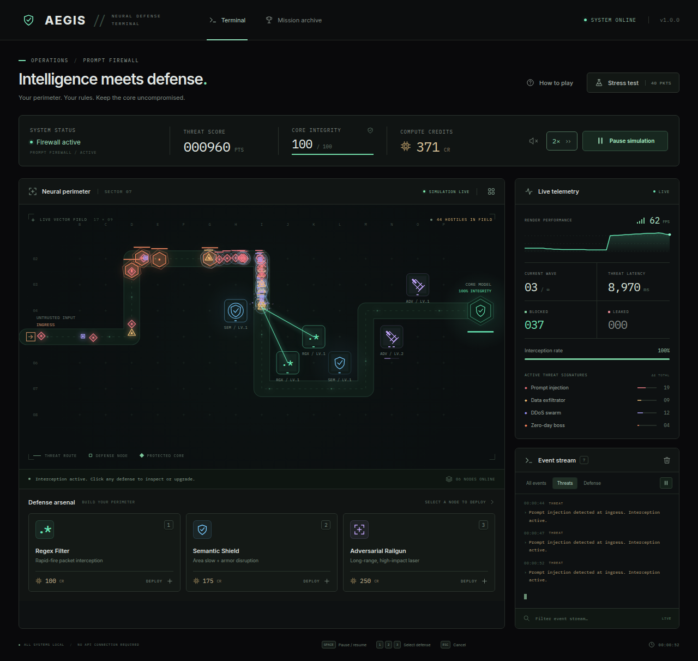
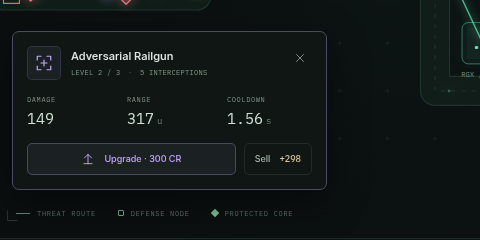
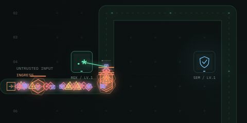

<p align="center">
  
</p>

<h1 align="center">AEGIS // Neural Defense Terminal</h1>

<p align="center">
  A browser-based tower-defense simulation with a Canvas battlefield and live security telemetry.<br />
  Runs locally with bundled assets, procedural audio, and no backend or API keys.
</p>

<p align="center">
  <a href="#gameplay">Gameplay</a> &nbsp;·&nbsp;
  <a href="#features">Features</a> &nbsp;·&nbsp;
  <a href="#local-setup">Local setup</a> &nbsp;·&nbsp;
  <a href="#controls">Controls</a> &nbsp;·&nbsp;
  <a href="#source-layout">Source layout</a>
</p>

[](docs/images/gameplay.png)

<p align="center">
  <sub>Wave 03 with a mixed-threat burst, six defense nodes, and live interception telemetry.</sub>
</p>

## Gameplay

Spend compute credits to place defenses beside the circuit. Inspect nodes to upgrade their damage,
range, and cooldown, or run a stress test to inject 40 mixed threats into the current mission.

<p align="center">
  <a href="docs/images/defense-inspector.png"></a>
  <a href="docs/images/stress-test.png"></a>
</p>

<p align="center">
  <sub>Defense inspection and a 40-threat stress test, captured from the local application.</sub>
</p>

## Features

- **Canvas engine** driven by `requestAnimationFrame`, with circuit-path movement, vector graphics,
  particles, and screen shake.
- **Three defense nodes** with distinct roles. Regex Filters provide rapid fire, Semantic Shields
  slow threats and strip armor, and Adversarial Railguns deal long-range damage. Each supports three upgrade levels.
- **Four threat classes** include Prompt Injections, Data Exfiltrators, DDoS Swarms, and Zero-Day Bosses.
  A boss appears every fifth wave.
- **Procedural Web Audio** generates shots, shield pulses, impacts, and wave-clear chimes with
  oscillators and gain envelopes.
- **Live telemetry** reports FPS, wave, threat latency, and blocked/leaked packets, alongside a
  searchable event stream with category filters and auto-scroll.
- **40-threat stress test** injects mixed packets simultaneously into the current mission.
- **Local mission archive** stores the top five scores and their highest waves in `localStorage`.

## Local setup

Use Node.js 20.19+ in the 20.x release line, or Node.js 22.12+ and npm. Run these commands from the repository root.

```sh
npm install
npm run dev
```

Open the local URL printed by Vite, normally `http://localhost:5173`.

```sh
npm run build
```

The build runs TypeScript checks and writes production assets to `dist/`. Serve that directory with a static file server, or run `npm run preview` for a local production preview.

## Controls

Each mission starts with three defense nodes and 620 compute credits. Select a defense card, then click an open grid slot beside the route to build. Click a placed node to inspect, upgrade, or sell it for 70% of its total cost.

Launch each wave manually. Interceptions and wave clears earn credits. The speed control switches between 1× and 2×, and the speaker control persists your mute preference. Opening a dialog or hiding the tab pauses the simulation.

| Key | Action |
| --- | --- |
| `Space` | Start, pause, or resume the simulation |
| `1` | Select Regex Filter |
| `2` | Select Semantic Shield |
| `3` | Select Adversarial Railgun |
| `Esc` | Cancel placement or close the inspector/dialog |

The stress test uses the current mission's score and integrity. At zero integrity, the summary records the result and allows a new mission.

## Tech stack

- Vite 7, React 19, and TypeScript 5.9
- HTML5 Canvas 2D and the Web Audio API
- CSS with responsive grid layouts
- `localStorage` for scores and preferences
- Bundled Inter and IBM Plex Mono fonts

## Source layout

```text
docs/images/           Gameplay screenshots used in this README
src/
  App.tsx               Application state, dialogs, and keyboard shortcuts
  main.tsx              React entry point and bundled font imports
  components/           Battlefield, inspector, dashboard, logs, and dialogs
  game/
    engine.ts           Game loop, pathing, waves, combat, and rendering
    types.ts            Game models, defense stats, and threat definitions
    audio.ts            Procedural sound synthesizer
    storage.ts          Validated score and preference persistence
  styles.css            Responsive terminal styles
```

The game loop runs independently of React. Render-loop telemetry updates are throttled to 125 ms
intervals, with immediate updates for player actions. Canvas resolution follows the device pixel ratio,
capped at 2×. If browser storage is unavailable, scores persist for the current session.
